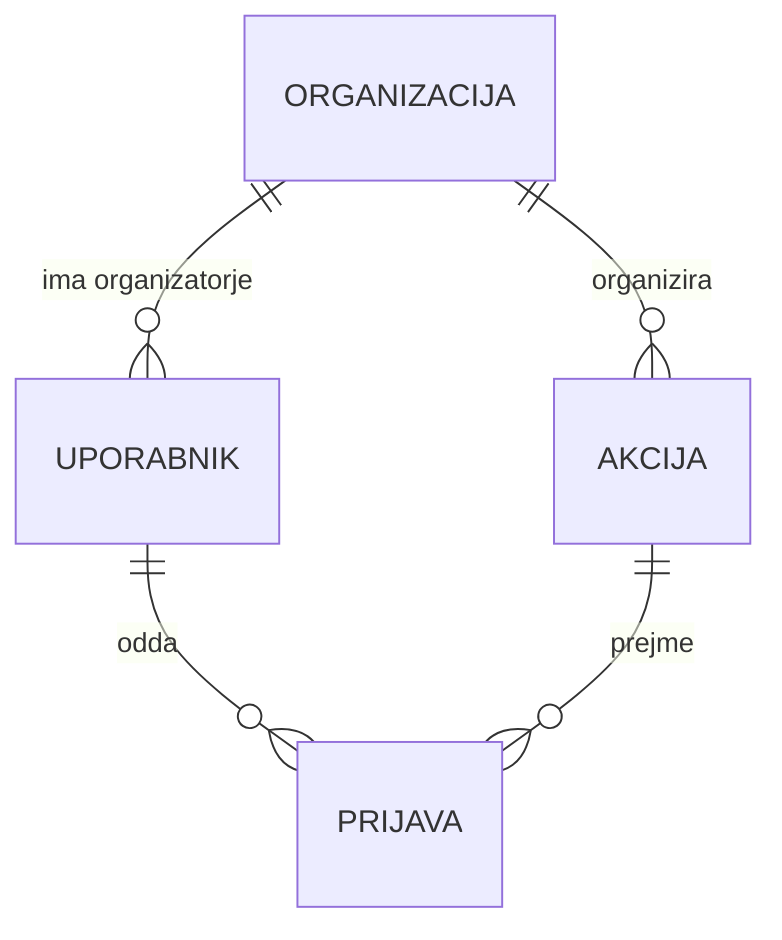
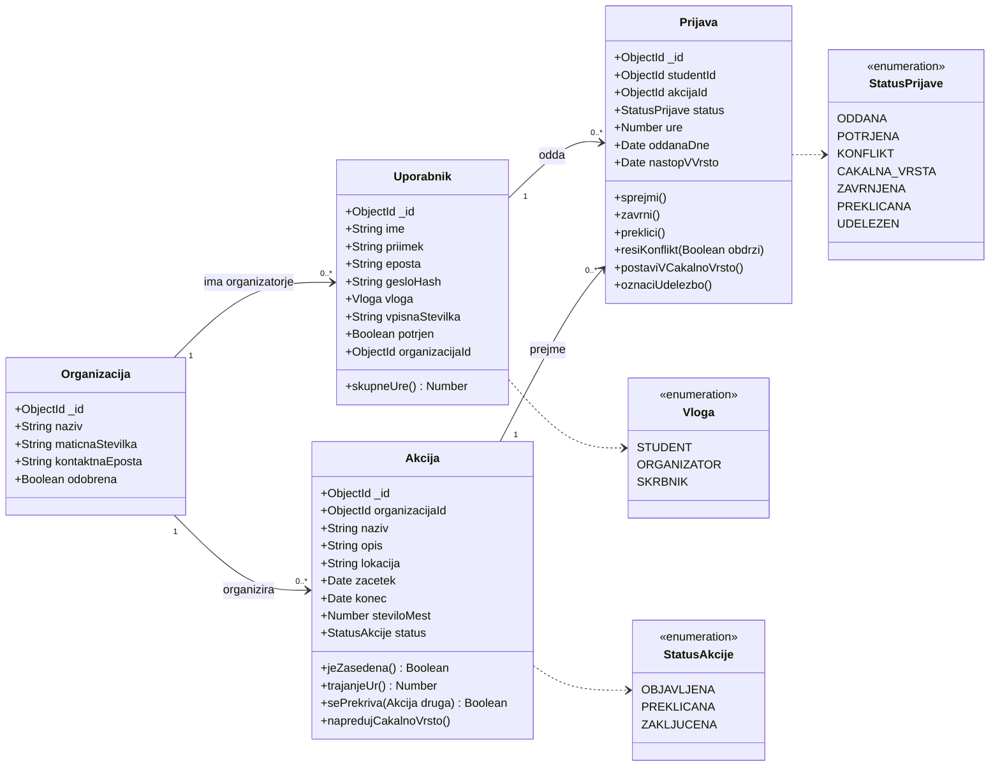
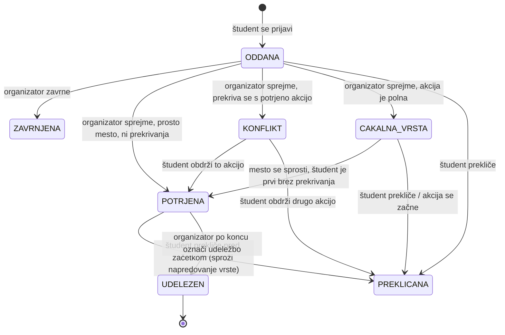
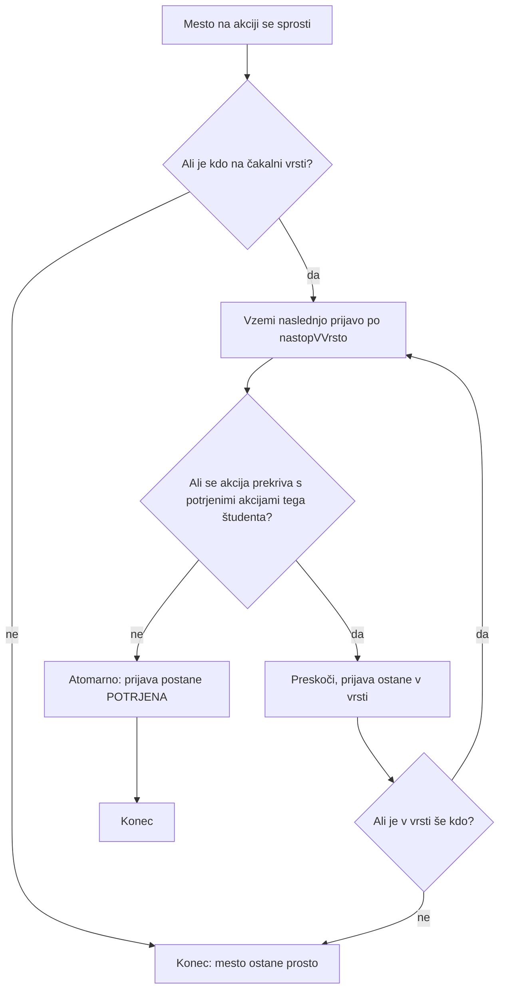

# Volunteero – Podatkovni model

Uporabljena je podatkovna baza **MongoDB** s shemami **Mongoose**. Vsaka entiteta je svoja zbirka, povezane pa so z referencami (`ObjectId`).

## 1. Entitete

### Uporabnik (`uporabniki`)
| Polje | Tip | Opis |
|---|---|---|
| `_id` | ObjectId | Primarni ključ |
| `ime`, `priimek` | String | Ime in priimek |
| `eposta` | String, unikaten | E-naslov za prijavo |
| `gesloHash` | String | Zgoščeno geslo |
| `vloga` | enum | `STUDENT`, `ORGANIZATOR`, `SKRBNIK` |
| `vpisnaStevilka` | String | Samo študent |
| `potrjen` | Boolean | Študenta potrdi skrbnik |
| `organizacijaId` | ObjectId → Organizacija | Samo organizator |

### Organizacija (`organizacije`)
| Polje | Tip | Opis |
|---|---|---|
| `_id` | ObjectId | Primarni ključ |
| `naziv` | String | Naziv organizacije |
| `maticnaStevilka` | String | Matična številka (AJPES) |
| `kontaktnaEposta` | String | Uradni e-naslov |
| `odobrena` | Boolean | Organizacijo odobri skrbnik |

### Akcija (`akcije`)
| Polje | Tip | Opis |
|---|---|---|
| `_id` | ObjectId | Primarni ključ |
| `organizacijaId` | ObjectId → Organizacija | Kdo organizira |
| `naziv`, `opis`, `lokacija` | String | Osnovni podatki |
| `zacetek`, `konec` | Date | Termin akcije |
| `steviloMest` | Number | Število potrebnih prostovoljcev |
| `status` | enum | `OBJAVLJENA`, `PREKLICANA`, `ZAKLJUCENA` |

### Prijava (`prijave`)
| Polje | Tip | Opis |
|---|---|---|
| `_id` | ObjectId | Primarni ključ |
| `studentId` | ObjectId → Uporabnik | Študent |
| `akcijaId` | ObjectId → Akcija | Akcija |
| `status` | enum | `ODDANA`, `POTRJENA`, `KONFLIKT`, `CAKALNA_VRSTA`, `ZAVRNJENA`, `PREKLICANA`, `UDELEZEN` |
| `ure` | Number | Ure, ko je študent udeležen |
| `oddanaDne` | Date | Čas prijave |
| `nastopVVrsto` | Date | Čas, ko je prijava prišla na čakalno vrsto (določa vrstni red) |

Indeks na (`akcijaId`, `status`, `nastopVVrsto`) omogoča hitro iskanje naslednje prijave v čakalni vrsti.

## 2. Povezave

| Povezava | Kardinalnost |
|---|---|
| Organizacija → Uporabnik (organizatorji) | 1 : 0..* |
| Organizacija → Akcija | 1 : 0..* |
| Uporabnik (študent) → Prijava | 1 : 0..* |
| Akcija → Prijava | 1 : 0..* |

Študent in akcija sta povezana **mnogo proti mnogo** prek zbirke `prijave`.

## 3. Diagram entitet

## 4. Razredni diagram

## 5. Stanja prijave

## 6. Potek napredovanja čakalne vrste

