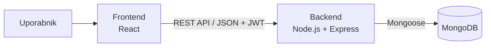

# Volunteero – Arhitektura in tehnološki sklad

## 1. Arhitektura

Aplikacija ima tri dele:

| Del | Naloga |
|---|---|
| **Frontend** (React) | Uporabniški vmesnik v brskalniku |
| **Backend** (Node.js + Express) | REST API, poslovna pravila (prekrivanja, konflikti, čakalna vrsta), avtentikacija |
| **Podatkovna baza** (MongoDB) | Hramba uporabnikov, organizacij, akcij in prijav |

**Komunikacija:** frontend pošilja zahtevke backendu prek **REST API-ja** (JSON). Backend do baze dostopa prek knjižnice **Mongoose**.

**Avtentikacija:** uporabnik se prijavi z e-naslovom in geslom. Geslo je shranjeno zgoščeno (**bcrypt**). Po prijavi dobi **JWT** žeton, ki ga frontend pošlje z vsakim zahtevkom. Backend iz žetona prebere vlogo in preveri, ali uporabnik sme izvesti dejanje.

### Diagram



### Primeri končnih točk

| Metoda | Pot | Kdo |
|---|---|---|
| POST | `/api/registracija`, `/api/vpis` | vsi |
| GET / POST | `/api/akcije` | vsi / organizator |
| POST | `/api/akcije/:id/prijave` | študent |
| PATCH | `/api/prijave/:id/sprejmi`, `/api/prijave/:id/zavrni` | organizator |
| PATCH | `/api/prijave/:id/resi-konflikt` | študent |
| PATCH | `/api/prijave/:id/preklici` | študent (sproži napredovanje čakalne vrste) |
| PATCH | `/api/prijave/:id/udelezba` | organizator |
| PATCH | `/api/skrbnik/uporabniki/:id/potrdi`, `/api/skrbnik/organizacije/:id/odobri` | skrbnik |

### Lokalni zagon

```bash
# backend
cd streznik
npm install
npm run dev        # http://localhost:5000

# frontend (nov terminal)
cd odjemalec
npm install
npm run dev        # http://localhost:5173
```

Pred zagonom mora biti lokalno nameščen in zagnan MongoDB. V datoteki `streznik/.env` sta nastavljena `MONGODB_URI` (npr. `mongodb://localhost:27017/volunteero`) in `JWT_SKRIVNOST`.

## 2. Tehnološki sklad

| Področje | Tehnologija |
|---|---|
| Frontend | React (Vite), React Router, Fetch API |
| Backend | Node.js, Express |
| Podatkovna baza | MongoDB (lokalno), MongoDB Compass, Mongoose |
| Avtentikacija | JWT, bcrypt |
| Lokalni razvoj | VS Code, Git, GitHub, npm, Postman |
| Testiranje | Jest |

## 3. Arhitekturne odločitve

- **Arhitektura odjemalec–strežnik z REST API-jem:** vsa poslovna pravila (prekrivanja, konflikti, čakalna vrsta) se izvajajo na strežniku, ker brskalniku ni mogoče zaupati.
- **Zakaj ne Firebase:** pri Firebase odjemalec dostopa neposredno do baze, zato bi bila zahtevna pravila težja za izvedbo, rešitev pa vezana na enega ponudnika.
- **Zakaj ne mikrostoritve:** za aplikacijo te velikosti bi bile nepotrebno zapletene.
- **React, Node.js in Express:** en jezik (JavaScript) za celoten projekt, ki ga že poznam.
- **MongoDB:** študenti in organizatorji imajo različna polja, kar dokumentna baza podpira naravno.
- **Mongoose:** doda sheme in preverjanje podatkov, ki jih MongoDB sam nima.
- **JWT in bcrypt:** JWT nosi vlogo uporabnika brez shranjevanja sej, bcrypt pa varno zgosti gesla.
- **Fetch API:** vgrajen v brskalnik, zato ne potrebujem dodatne knjižnice.

Podrobna utemeljitev posameznih odločitev je v mapi [`adr/`](adr/).