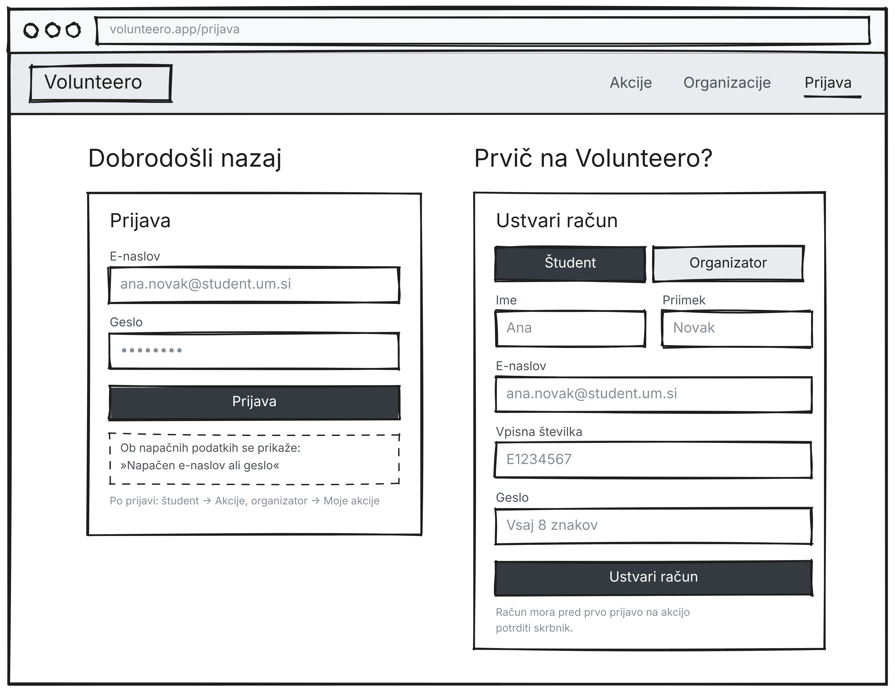
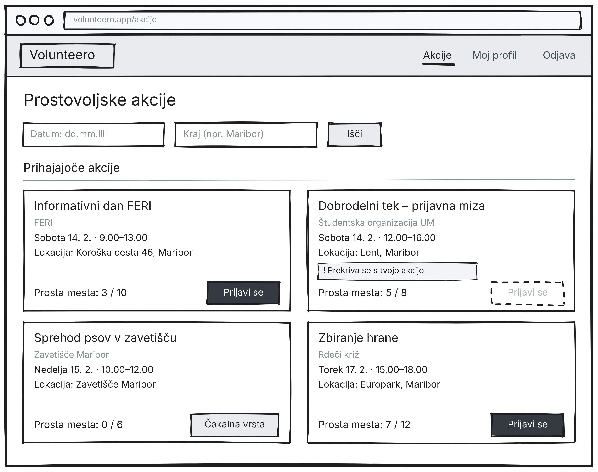
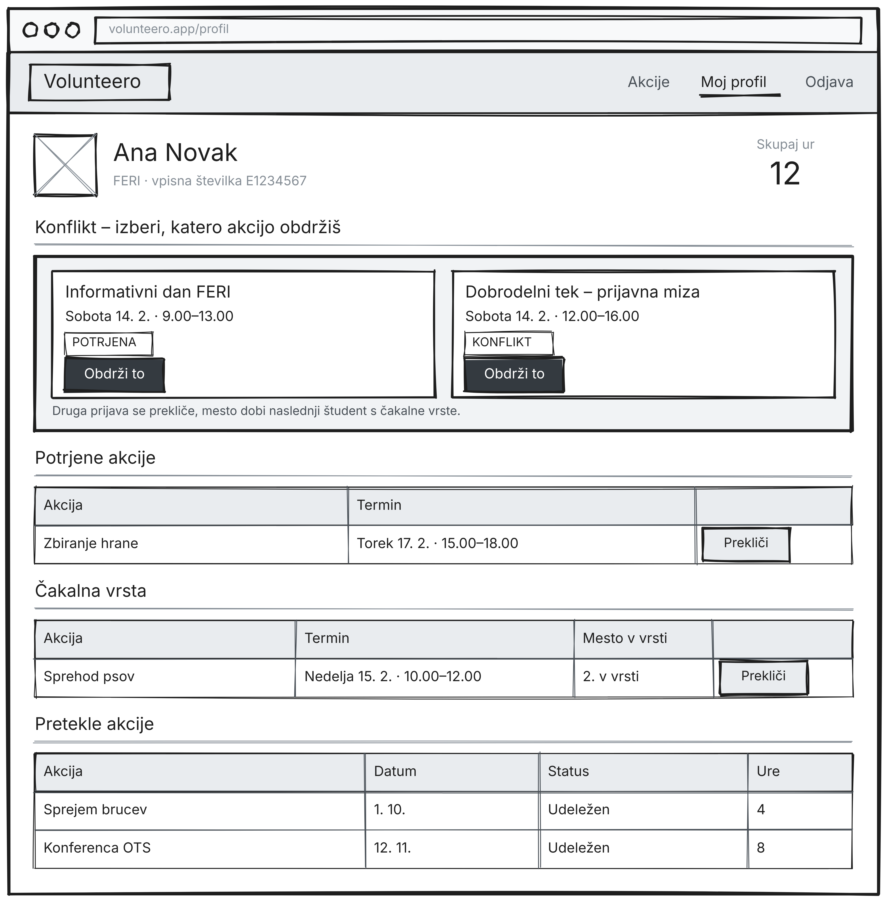
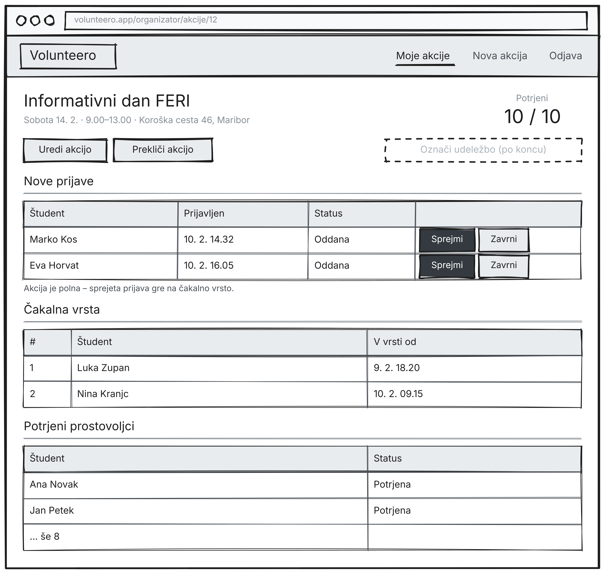
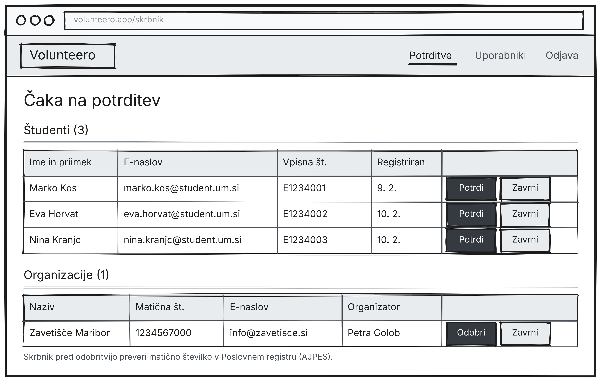

# Volunteero – Wireframes

Wireframe sem naredila v orodju **Excalidraw**. Prikazujejo samo razporeditev elementov na zaslonu (meni, polja, gumbi, tabele), brez barv in končnega oblikovanja. Izvorne datoteke (`.excalidraw`) so v mapi `wireframes/` in jih je mogoče odpreti na excalidraw.com.

## 0. Prijava in registracija

Na levi je obrazec za prijavo z e-naslovom in geslom, na desni registracija novega računa. Uporabnik izbere, ali je študent ali organizator; študent vpiše tudi vpisno številko. Nov račun mora pred prvo prijavo na akcijo potrditi skrbnik.

**Uporabniške zgodbe:** US-01, US-02, US-03

## 1. Seznam akcij (študent)

Začetna stran študenta. Zgoraj sta filtra po datumu in kraju, spodaj kartice akcij z organizacijo, terminom, lokacijo in številom prostih mest. Akcija, ki se prekriva s potrjeno akcijo študenta, je označena in prijava nanjo ni mogoča. Pri polni akciji se študent prijavi na čakalno vrsto.

**Uporabniške zgodbe:** US-07, US-15

## 2. Profil študenta

Na vrhu so podatki študenta in skupno število ur. Če ima študent konflikt, se prikaže okvir z obema akcijama in gumboma »Obdrži to«. Spodaj so ločeno prikazane potrjene akcije, čakalna vrsta z mestom v vrsti in pretekle akcije z urami.

**Uporabniške zgodbe:** US-09, US-11, US-12, US-13

## 3. Upravljanje prijav (organizator)

Organizator vidi podatke akcije in število potrjenih prostovoljcev. Nove prijave lahko sprejme ali zavrne; ker je akcija polna, sprejeta prijava gre na čakalno vrsto, ki je prikazana po vrstnem redu. Gumb »Označi udeležbo« postane aktiven šele po koncu akcije.

**Uporabniške zgodbe:** US-08, US-10, US-14

## 4. Potrditve (skrbnik)

Skrbnik vidi seznam študentov, ki čakajo na potrditev, z vpisno številko, in seznam organizacij, ki čakajo na odobritev, z matično številko. Pri vsakem vnosu lahko potrdi oziroma odobri ali zavrne.

**Uporabniške zgodbe:** US-04, US-05